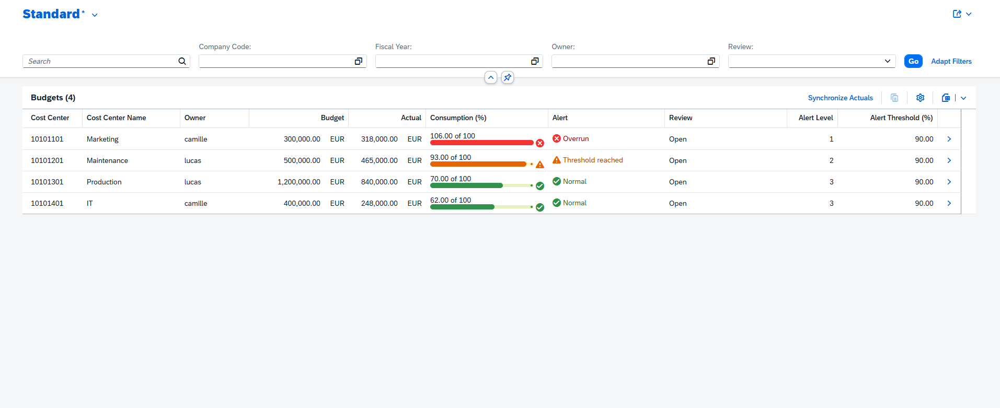
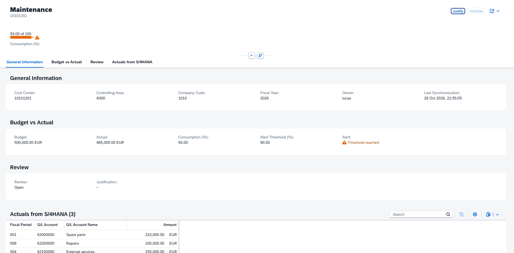
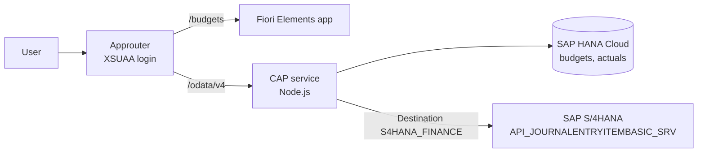
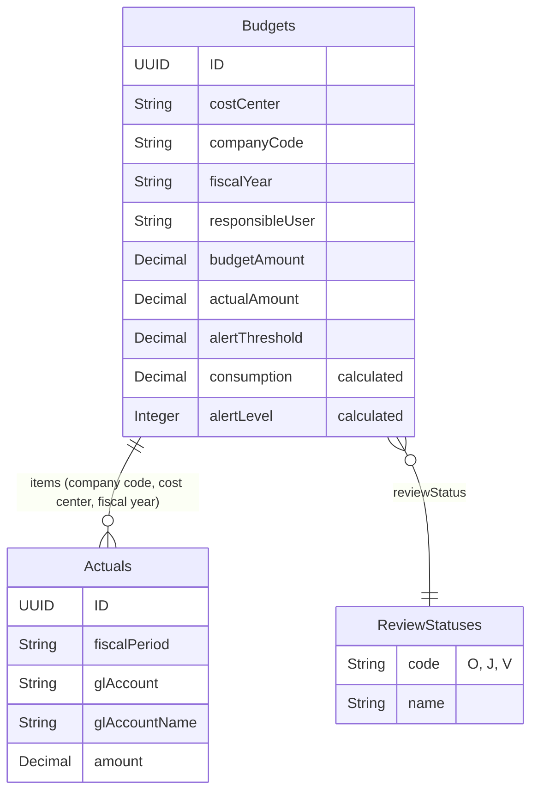

# Budget Monitoring Cockpit

**SAP BTP side-by-side extension for SAP S/4HANA Finance (Controlling)**

Management controllers often discover budget overruns at period-end close, too late to react. The data is in S/4HANA, but spread across journal entries, cost centers and G/L accounts.

This app gives controllers a single cockpit: it compares each cost center's budget with its actual costs from S/4HANA, flags overruns before close, and runs a short review workflow where the cost center owner justifies the overrun and the controller validates it.

Built with **SAP CAP (Node.js)**, **SAP Fiori Elements**, and deployed on **SAP BTP Cloud Foundry** with **SAP HANA Cloud**, **XSUAA** and the **Destination service**, following **Clean Core** principles: nothing is modified in S/4HANA.



---

## Features

- **Budget vs actual by cost center**, with consumption as a progress bar and color-coded alerts: green (normal), orange (threshold reached), red (overrun)
- **Actuals synchronized from S/4HANA** through the standard API `API_JOURNALENTRYITEMBASIC_SRV`
- **Detail page** with the S/4HANA actuals by fiscal period and G/L account
- **Review workflow**: the cost center owner justifies an overrun, the controller validates it
- **Role-based access**:
  - `BudgetController` sees all budgets, synchronizes actuals and validates justifications
  - `CostCenterOwner` only sees their own cost centers (instance-based authorization) and justifies overruns



---

## Architecture



| Layer | Technology | Role |
|---|---|---|
| UI | SAP Fiori Elements (List Report + Object Page), OData V4 annotations | Screens generated from CDS annotations |
| Entry point | SAP Approuter | XSUAA login, serves the UI, forwards API calls with the user token |
| Backend | SAP CAP (Node.js) | Data model, OData V4 service, authorization, sync and workflow logic |
| Database | SAP HANA Cloud (HDI container) | Budgets, replicated actuals, review status |
| Integration | BTP Destination service + SAP Cloud SDK | Calls the S/4HANA API without credentials in the code |
| Security | XSUAA | Roles `BudgetController` and `CostCenterOwner` |

---

## Design choices

**Side-by-side extension (Clean Core).** Budgets and the review workflow live on BTP. S/4HANA is only read through a released standard API, so the core system stays untouched and upgrade-safe.

**Replication instead of live calls.** Actuals are copied into HANA by the `syncActuals` action. The cockpit stays fast and doesn't load S/4HANA on every screen. The sync is idempotent: running it twice gives the same result.

**Business rules applied to S/4HANA data.** The sync only keeps:
- the **leading ledger** (`0L`), so parallel ledgers don't count postings twice
- the requested **fiscal year** and the **budgeted cost centers**
- **expense accounts** (5xxxxxxx and 6xxxxxxx in SAP's standard chart of accounts YCOA). Connecting to real S/4HANA data first showed a negative consumption: the cost center also carried revenue (4xxxxxxx) and a GR/IR clearing account (2xxxxxxx). Restricting the sync to expense accounts fixed it.

**Calculated elements.** Consumption and alert level are CDS calculated elements, so they are always consistent with the amounts. The alert level uses Fiori's criticality values (1 red, 2 orange, 3 green) directly.

**Rules enforced on the server.** Fiori disables the Justify and Validate buttons when they don't apply (`@Core.OperationAvailable`), but the service checks the same rules, because the API can be called directly.

**Same code, different environments.** CAP profiles switch the configuration without changing the code:

| | Development (`cds watch`) | Production (BTP) |
|---|---|---|
| Database | SQLite in memory | SAP HANA Cloud |
| Authentication | Mocked users | XSUAA |
| S/4HANA API | Mocked locally with CSV data | Real API through the `S4HANA_FINANCE` destination |

---

## Data model



---

## Project structure

```
budget-cockpit/
├── app/
│   └── budgets/
│       ├── annotations.cds        # Fiori Elements UI annotations
│       └── webapp/                # Fiori app (manifest, component, launch page)
├── db/
│   ├── schema.cds                 # Budgets, Actuals, ReviewStatuses
│   └── data/                      # Sample budgets and mocked S/4HANA data
├── srv/
│   ├── cockpit-service.cds        # Service, roles, actions
│   ├── cockpit-service.js         # Sync and review workflow logic
│   └── external/                  # Imported S/4HANA API definition
├── test/
│   └── requests.http              # API test requests for each role
├── .deploy/app-router/            # Approuter configuration
├── mta.yaml                       # BTP deployment descriptor
└── xs-security.json               # XSUAA roles
```

---

## Run locally

Requirements: Node.js 20+, `@sap/cds-dk` installed globally.

```bash
npm install
cds watch
```

Open http://localhost:4004. Locally, the S/4HANA API is mocked and three test users are available (empty password):

| User | Role | Sees |
|---|---|---|
| `controller` | BudgetController | All 4 budgets |
| `camille` | CostCenterOwner | Marketing, IT |
| `lucas` | CostCenterOwner | Maintenance, Production |

Then:
1. Open the app at `/budgets/webapp/index.html` as `controller`.
2. Click **Synchronize Actuals** with fiscal year `2026`.
3. Marketing shows an overrun (106 %), Maintenance reaches the threshold (93 %).
4. As `camille`, justify the Marketing overrun. As `controller`, validate it.

`test/requests.http` contains the same scenario as API calls, including the requests that must be refused.

---

## Deploy to SAP BTP

Requirements: a BTP subaccount with Cloud Foundry, a running SAP HANA Cloud instance mapped to the space, and the MTA Build Tool and Cloud Foundry CLI (both included in SAP Business Application Studio).

```bash
cf login
mbt build
cf deploy mta_archives/budget-cockpit_1.0.0.mtar
```

Then in the BTP cockpit:
1. **Assign roles**: Security > Users > assign the role collection `BudgetController (budget-cockpit …)` and/or `CostCenterOwner (budget-cockpit …)`.
2. **Create the destination** `S4HANA_FINANCE`, for example to the SAP API Business Hub sandbox:

| Field | Value |
|---|---|
| Type | HTTP |
| URL | `https://sandbox.api.sap.com/s4hanacloud` |
| Proxy Type | Internet |
| Authentication | NoAuthentication |
| Additional property `URL.headers.APIKey` | your API key from api.sap.com |

For a real S/4HANA system, only the destination changes.

---

## Limitations and next steps

- The expense account range is set for SAP's standard chart of accounts (YCOA). Next step: make it configurable per client.
- Budgets are loaded from CSV. Next step: let controllers maintain budgets in the app (Fiori draft) or import them from SAP Analytics Cloud planning.
- Add automated tests with `cds.test`.
- Notify cost center owners when a threshold is reached (SAP Event Mesh or email).

---

## Author

**Amin Mesmoudi**
[LinkedIn](https://www.linkedin.com/in/aminmesmoudi13/) · [GitHub](https://github.com/mmed9min)